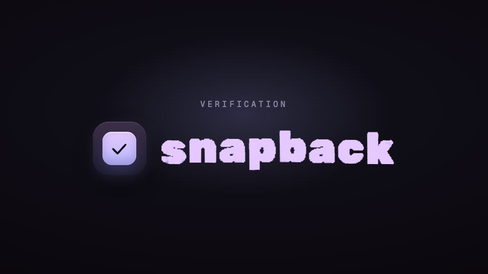

# Snapback

> THIS PROJECT WAS MADE PARTIALLY USING AGENTIC AI CODING TOOLS

> **WIP:** unfinished and not working in its current state. A lot is left to do.



[](LICENSE)
[](docs/contributing.md)
[](https://bun.sh)
[](https://discord.com/developers/docs/components/overview)
[](docs/self-hosting.md)

Members verify once, and you can add them back to any server you own, whenever you want. Self-hosted, no per-member fee, and the database is yours.

## Pulling members

The RestoreCord trick, without their servers in the middle.

`/setup verify` posts a panel in a channel you choose. It asks for `identify`, `email`, and `guilds.join` by default. The other seven scopes are checkboxes, each with the consequence of granting it written underneath.

Pressing the button opens Discord's own consent screen. The code comes back to your domain, gets exchanged, and the tokens are stored with AES-256-GCM. A token never appears in a page, a log line, or an export.

`/pull start` queues the pull as a job. You get a plan first: who will be tried, and who will not. Each join is one `PUT /guilds/{guild}/members/{user}` carrying that member's own token. No join links, no user tokens, and the bot's own token never adds anyone.

Limits keep accounts alive instead of hammered. 100 attempts per account per day, a 60 minute cooldown after a run of failures, 24 hours on hold when Discord restricts an account. A revoked grant is skipped. A stale token gets one refresh; a second 401 marks the grant dead. All three limits are per-guild settings, and `/pull counters` shows where every account stands today.

Around it: `/verify panel`, `/verify records`, `/verify record`, `/verify refresh`, `/verify delete`, `/verify stats`, `/users lookup`, `/users export`, `/users blacklist`. Alt detection reads local IP and ASN files, so no third party sees your members' addresses.

## Backup and restore

`/backup create` captures roles, channels, overwrites, threads, members, messages, bans, emoji, stickers, soundboard, automod, and scheduled events. Assets are downloaded, not linked, because Discord's signed CDN urls expire and a backup of bare urls restores blank icons six months later.

`/restore plan` prints what a restore would change before it changes anything. Restores are category by category, resumable across a restart, and report what they could not do. `/restore members` and `/restore messages` run either half alone.

## Snapback vs the hosted ones

| | Snapback | RestoreCord | VaultCord |
|:--|:--|:--|:--|
| where it runs | your box | their servers | their servers |
| cost | nothing, MIT | paid tiers | paid tiers |
| source | read all of it | closed | closed |
| member records live in | your database | their database | their database |
| the verify page | yours, your domain | theirs | theirs |
| add a member | their token, one call | their token, one call | their token, one call |
| who debugs it at 3am | you | their support | their support |
| time to first pull | an evening | minutes | minutes |

You are not paying less for a worse product. You are paying in setup time and ops instead of a subscription. Their plan limits and prices change, so check their sites rather than trusting this table.

## The catch

Be honest with yourself before you deploy it.

- **A public https url**: Discord sends the OAuth code back to a redirect, and it cannot be `localhost`. A domain with a certificate, or a tunnel. `docs/cloudflare-tunnel.md` covers the tunnel and the loopback IP failure that bites everyone once.
- **A Discord application**: client id, client secret, the redirect string in the portal, and the server members intent. `docs/developer-panel.md` walks the portal screens.
- **A machine that stays awake**: one process holds the bot, the web server, and the scheduler. DuckDB takes one writer, so a separate site process wants Postgres.
- **Discord sets the clock**: restores go through webhooks at about 2.5 posts a second. Ten thousand messages is roughly an hour, and no amount of tuning changes that.
- **No support line**: a troubleshooting guide and a diagnostics command, not a human.
- **Pull still needs consent**: a bot cannot add someone who never verified. Anyone without `guilds.join` stays out, by design and by Discord's rules.

## Run it

```bash
bun install
cp .env.example .env
bun run dev
```

Fill `DISCORD_TOKEN`, `DISCORD_OWNER_ID`, `DISCORD_CLIENT_ID`, `OAUTH_CLIENT_SECRET`, and `PUBLIC_BASE_URL`. Migrations run at boot. For encrypted token storage set `ENCRYPTION_KEY` from `openssl rand -base64 32`. Full walkthrough: `docs/setup.md`.

## Docs

| | |
|:--|:--|
| `docs/setup.md` | clone to a verified member |
| `docs/commands.md` | every slash command |
| `docs/scopes.md` | what each OAuth scope grants |
| `docs/privacy.md` | what is captured, and how to store it |
| `docs/backup-format.md` | the JSON contract and what a restore cannot undo |

## License

MIT, copyright 2026 M1noa.
